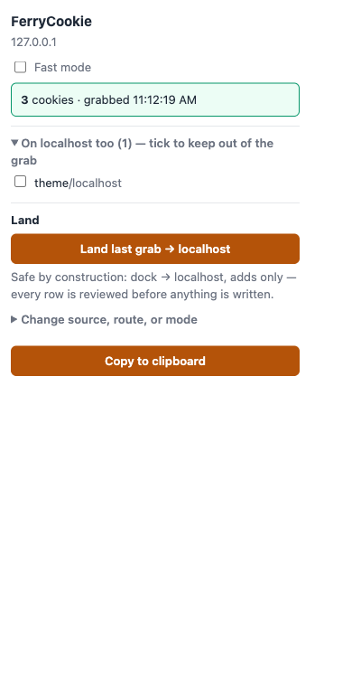
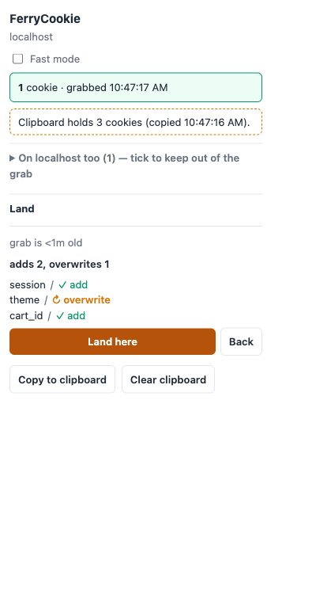
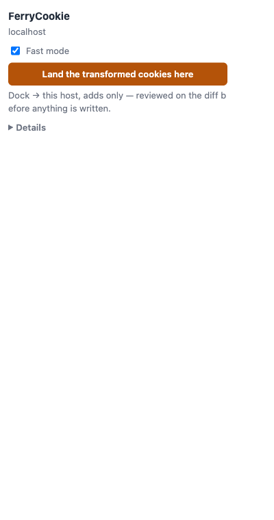
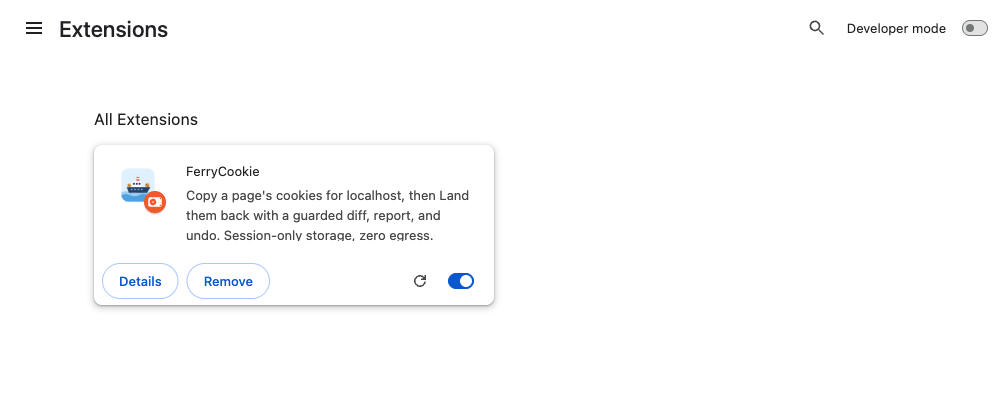

<p align="center">
  
</p>

# FerryCookie

[](https://developer.chrome.com/docs/extensions/develop/migrate/what-is-mv3)
[](#is-it-safe)
[](#is-it-safe)

One-gesture localhost cookie ferry, both directions. **Copy**: click,
context-menu, or shortcut puts a live site's cookies on your clipboard as
EditThisCookie-v3 JSON with every host rewritten to `localhost`. **Land**:
paste or reuse that grab, see exactly what would happen, and put the session
onto a local jar — with a per-row report and one-click undo.

Vanilla JS, no build step, no bundler — the whole extension is reviewable in
one sitting. That is the security pitch.

## The problem it solves

Cookies are how a site knows you are logged in. When you develop locally,
your dev server (`http://localhost:3000` or similar) has a **cookie jar of
its own** — and that jar starts empty. So your local app treats you as a
stranger, even though you are logged into the real site in the next tab.

The manual fix is fiddly: DevTools → Application → Cookies, copying rows
one by one, fixing the domain to `localhost`, redoing it whenever the
session rotates. It is easy to miss a cookie — or to leak a session value
into a note app along the way.

FerryCookie does the ferry for you, both directions:

- **Copy** — one gesture on the logged-in site (a *grab*). Every host is
  rewritten to `localhost` before anything touches your clipboard.
- **Land** — a guarded write onto your local jar: you see a diff of
  exactly what would happen, you confirm, you get a report verified
  against the jar, and you can undo with one click.

Three words used throughout, defined once: a *jar* is Chrome's per-domain
cookie store; a *grab* is one copied session; the *dock* is the extension's
session-scoped holding area for the latest grab, so the same-browser loop
does not even need the clipboard.

## Key features

| Feature | What it means for you |
|---|---|
| One-gesture copy | Popup button, right-click menu, or `Ctrl/Cmd+Shift+9` — the clipboard holds EditThisCookie-compatible JSON with hosts already rewritten to `localhost`. |
| Guarded landing | A diff screen before anything is written, four modes (fill-gaps / merge / replace / curated), a report verified by re-reading the jar, and one-click undo. |
| Fast mode | The popup becomes one button per side: *Grab the cookies* on the site, *Land the transformed cookies here* on localhost. **Land here & Reload** finishes the whole loop in two clicks, with no mouse travel. |
| Protect list | Tick a cookie name and the ferry never grabs it and never lands over it — honored in both directions. |
| Refusals, named | Foreign domains, empty jars, stale or unparseable input are refused with the reason spelled out. Nothing happens silently. |
| Reset | One click beside the Land button clears the docked grab, the credential state, and the clipboard — never your protect list, your undo snapshots, or the landed jar. |
| Zero egress, session-only storage | No network calls, no telemetry; cookie data lives in `storage.session` and dies with the browser. |

| Copy | Land | Fast mode |
|---|---|---|
|  |  |  |

The whole loop in real screenshots — copy, land, proof, undo, refusals,
fast mode — is [docs/showcase.md](docs/showcase.md).

## Is it safe?

Yes — and you do not have to take anyone's word for it. Everything below
is verifiable in the source you are about to load:

- **The files you read are the files Chrome runs.** No build step, no
  bundler, no dependencies — plain JavaScript modules, nothing generated.
  Suggested reading order: `src/popup/popup.js` (the UI),
  `src/core/rewrite.js` (the copy core), `src/core/landing.js` (the
  landing contract).
- **Zero egress.** The extension never makes a network request. Search the
  source for `fetch`, `XMLHttpRequest`, or `WebSocket` — there are none.
  Your cookies go to your clipboard and to a session-scoped store, and
  nowhere else.
- **Nothing persists.** Cookie values live only in `storage.session` and
  are gone when the browser closes. The single exception is the Fast-mode
  toggle — a boolean, no data.
- **Every write is a reviewed gesture.** A diff screen precedes every
  landing; the destructive replace mode makes you type `LAND`; every
  landing snapshots the jar first, so undo is one click.
- **Values render as text, always.** Cookie values enter the UI via
  `textContent`, never as HTML — there is no injection surface in the
  popup.

**What each permission is for:**

| Permission | Why it exists |
|---|---|
| `cookies` + `<all_urls>` | Reading the cookies of whichever site you are logged into — any site, because that is the point. Nothing else in the extension reads pages. |
| `clipboardWrite` | The copy gestures. |
| `clipboardRead` | The Land flow's clipboard lane — read only at your explicit **Read input** click. (The paste lane needs no clipboard permission at all.) |
| `contextMenus`, `offscreen`, `storage` | The right-click gesture, the clipboard fallback that works outside the popup, and session-scoped state. |

**Verify it yourself in five minutes:** `make test` (93 unit checks) and
`make e2e` (16 end-to-end checks driving a real Chromium through the whole
loop) — see [Verify](#verify).

## Install from source (developer mode)

You will load the code directly — no store, no packaging. Chrome calls
this *unpacked*.

1. **Get the code** — `git clone https://github.com/pwn-0x309/ferry-cookie-crx.git`
   (or *Code → Download ZIP* on GitHub, then unzip it).
2. **Open the extensions page** — type `chrome://extensions` in the address
   bar. On macOS you can run `make run` from the repo instead; it opens
   the page in Google Chrome.
3. **Turn on Developer mode** — the toggle in the top-right corner of the
   extensions page.
4. **Load unpacked** — click *Load unpacked* and select the `ferry-cookie`
   folder: the one containing `manifest.json`, not its parent.
5. **Pin it** — click the puzzle-piece icon in Chrome's toolbar and pin
   FerryCookie, so the ferry is always one click away.



Notes, so that nothing surprises you:

- The card carries an **Unpacked** badge — it means *loaded from a
  folder*, which is exactly what you did on purpose.
- Chrome may show a *developer mode extensions* notice when the browser
  restarts. That is the standard reminder that an unpacked extension is
  present — safe to dismiss.
- **Updating** — after `git pull`, click the ↻ *Reload* icon on the
  extension's card. That is the whole update procedure.
- **Removing** — the *Remove* button on the card. Nothing is left behind,
  because nothing was persisted.

## Quick start (60 seconds)

1. Open a site you are logged into. Click the FerryCookie icon → **Copy to
   clipboard** (or flip **Fast mode** on and click **Grab the cookies**).
2. Open your local dev server — any `http://localhost:<port>`.
3. Click the icon again → **Land last grab → localhost** (in fast mode:
   **Land the transformed cookies here**, then **Land here & Reload**).
4. The page reloads with your session live. Done — and **Undo** on the
   report screen puts the jar back whenever you want.

---

Everything below is the precise contract — the same content the extension
is tested against.

## Layout

```
manifest.json                     MV3: permissions, command, context menu, offscreen
src/core/rewrite.js               pure copy core: rewrite(sourceOrigin, targetOrigin)
                                  + jar dedupe/preview/protect + partitioned exclusion
src/core/landing.js               pure landing core: sniff → validate → retarget →
                                  planLanding → report buckets (the contract of
                                  spec-ferry-cookie-apply)
src/serializers/etc-v3.js         ETC v3 dialect: serialize (byte-stable) + parse
src/serializers/envelope.js       FC envelope dialect (the dock): serialize + parse
src/serializers/playwright.js     Playwright addCookies dialect: serialize + parse
src/shared/grab.js                chrome.* read helpers shared by popup and worker
src/shared/land.js                landing runtime: lanes, writes, snapshots,
                                  jar re-read verify
src/popup/                        receipt, guards, preview, protect list, clear,
                                  and the Land flow (diff screen, modes, routes,
                                  report, undo, textarea fallback)
src/background/service-worker.js  context-menu + command triggers; dock write
src/offscreen/                    clipboard fallback (DOM) outside the popup
spike/                            set() fidelity matrix results (throwaway probes)
test/fixtures/F1..F14.json        golden fixtures — copy (F1–F10) and landing
                                  (F11–F14) contracts
test/unit/                        node --test around the cores + dialects
test/e2e/                         Playwright: load unpacked, replay F1/F3/F10,
                                  the whole loop, refusals, undo
```

## Copy — the grab

- **Popup (primary):** click the FerryCookie action. The receipt shows the
  cookie count, the source host, and the grab time. *Copy to clipboard* is
  the only thing that writes the clipboard, and only on your click.
- **Preview & protect:** the popup lists cookies present on both the grab
  and the local `localhost` jar (ports share one jar) in a collapsed-by-default
  **On localhost too** disclosure — it auto-expands on open while anything is
  protected. Tick a cookie to protect it: protected names never enter the
  JSON and are listed in the popup. The protect list (names only) lives in
  `storage.session`.
- **Clear:** after any copy the popup shows *clipboard holds credentials*
  with a one-tap **Clear clipboard**.
- **Context menu / shortcut:** right-click → *Copy cookies as localhost
  JSON*, or `Ctrl/Cmd+Shift+9`. These write the clipboard through an
  offscreen document and set the badge to the emitted count.

## Fast mode

A toggle at the top of the popup (persists across restarts — it is a UI
preference, not data). When on, the popup is one button for the side you
are on:

- **On the source site** (anything outside the `localhost` family — real
  sites, and the `127.0.0.1`/`[::1]` production stand-ins): **Grab the
  cookies**. On success: *Collected {n} cookies from {site}*.
- **On the destination** (`localhost`, `*.localhost`): **Land the
  transformed cookies here** — the pinned quick path (dock lane, add-only
  fill-gaps, this host) ending on the same reviewed diff, whose confirm row
  appears at the same spot: **Land here & Reload** finishes the loop with a
  refreshed page in two clicks, no mouse travel. Fast mode removes clicks
  *before* the write, never the review of the write.
- **Reset** (beside the Land button): clears the ferry itself — the docked
  grab, the credential state, and the clipboard — for one-click session
  hygiene. It never touches the protect list (a standing protection), the
  undo snapshots, or the landed jar.
- Everything else — receipt, flags, protect list, the full land controls —
  folds into a **Details** disclosure, closed by default.

## Land — the guarded write

Every successful copy also refreshes the **dock** — the session-scoped copy
of the grab (an FC envelope: the same ETC rows plus `grabbedAt` /
`sourceOrigin` metadata). The Land flow lives in the popup below the copy
surface, and leads with a **quick action** — *Land last grab → localhost*,
pinned to dock lane, `localhost`, fill-gaps, no advanced toggle, whatever the
controls or session prefs say. The controls themselves (steps 1–3) sit behind
a collapsed *Change source, route, or mode* disclosure:

1. **Pick a lane** — *Dock (last grab)*, *Clipboard* (read at the Read
   click, never at popup-open), or *Paste* (a textarea; needs no clipboard
   permission at all).
2. **Pick a jar and a mode** — target `localhost`, `127.0.0.1`, or `[::1]`;
   mode *fill-gaps* (default — only names the jar lacks; can never destroy),
   *merge* (upsert), *replace* (clear + write), or *curated* (tick rows on
   the diff screen). The chosen lane/route/mode persist for the session
   only.
3. **Read input** — the click parses the lane. Dialects are sniffed in a
   pinned order (ETC v3 → FC envelope → Playwright `addCookies`); input
   that fits two dialects asks you to pick, never guesses. Unparseable or
   empty input disables Land naming the reason.
4. **The diff screen** — the action row leads the screen (in fast mode it
   renders exactly where the fast Land button was, so the second click needs
   no mouse travel): **Land here & Reload** (lands, verifies, then reloads
   the page — shown only when the active tab is the target), plain
   **Land here**, and **Back**. Below it: pre-flight math ("adds 4,
   overwrites 1, excludes 2 foreign"), a freshness line ("grab is 5m old";
   bare arrays say "age unknown"), and, in replace mode, a typed `LAND`
   confirmation. Fill-gaps/merge/curated confirm with one click. Enter
   confirms, Esc backs out.
5. **The report** — every row's fate in exactly one bucket:
   `landed` / `overwritten` / `skipped-foreign` / `skipped-protected` /
   `invalid` / `failed` — plus `removed` for replace-mode removals, and a
   kept-count for fill-gaps rows already present (never written, never
   excluded). Counts are asserted by re-reading the jar after the writes,
   never by trusting the write calls; partial success is loud.
6. **Undo** — the jar is snapshotted before the first write of every
   landing; the report screen offers a one-click restore (itself shown
   diff-then-confirm, so undo can never become the new accident).

### What Land will never do

- **Write outside the confirmed jar.** Rows whose domain is loopback-shaped
  (`localhost`, `127.0.0.1`, `[::1]`, `*.localhost` — dot-insensitive)
  retarget onto the chosen target; every other domain is reported
  `skipped-foreign` and never written. A clipboard seeded with
  `.internal.corp` rows lands zero of them.
- **Land automatically.** Every landing is an explicit gesture.
- **Touch protected names.** The v1 protect list excludes names from
  landing in every mode (`skipped-protected`), and replace never removes
  them. Restores are the deliberate exception: a snapshot is the whole
  truth of the jar at grab time, so restoring one rebuilds every row it
  holds — protected or not.
- **Write a remote host silently.** The default build writes only the three
  loopback jars. An *Advanced* toggle unlocks remote targets one host at a
  time, with a standing warning: **a landed session acts as you against
  that backend.**

### Capacity

Chrome silently evicts cookies near ~180 per jar (the spike in `spike/`
measured it: 220 successful `set()` calls left 159 rows). When a landing
would push the jar past that line, Land offers an inline *auth-class only*
filter (`session|auth|token|jwt|^sid`) instead of failing — and the
post-write jar re-read catches anything the browser dropped anyway
(`failed` bucket).

## httpOnly deviation (read this)

Our dialects never emit `httpOnly` — the frozen ETC v3 field list stands
(human ruling, reaffirmed 2026-09-28). A landed session may therefore be
JS-readable on localhost where its production original was httpOnly. If you
need the httpOnly bit preserved, import the clipboard JSON via
EditThisCookie instead. Foreign ETC exports that *do* carry `httpOnly`
inbound are accepted and landed verbatim.

## Permissions posture

Preferred posture was C (`activeTab`, no standing host permissions).
Spike #0 could not produce the required user gesture in an automated
environment, and the `chrome.cookies` API is documented to return "only
cookies for domains that the extension has host permissions to" while
community evidence says it ignores `activeTab`'s temporary grant — so this
build ships the spec's fallback: `host_permissions: ["<all_urls>"]`, the
broadest-necessary set because the source site is arbitrary. Nothing else
about the extension reads pages; the permission exists only so
`cookies.getAll` can see the active tab's jar.

To revisit: remove `host_permissions` from `manifest.json`, add
`"activeTab"` to `permissions`, load unpacked, and click the action on a
logged-in page. If cookies appear, posture C works on your Chrome — flip
the manifest and keep the rest unchanged.

`clipboardWrite` exists for the alternate copy gestures only. `clipboardRead`
(spike-verified: read-at-click works prompt-free in the popup) exists for
the Land flow's clipboard lane; the textarea lane ships regardless and
needs no clipboard permission — that is the IT-approvable path. No code
path reads the clipboard except the explicit **Read input** click.

## Security notes

- Zero egress, zero telemetry.
- Cookie values at rest live only in `storage.session` — the dock grab and
  the undo snapshots. **Snapshots die with the browser; that is the
  retention policy.** Up to 3 are kept, oldest evicted. The one deliberate
  exception: the Fast-mode boolean (a UI preference, no cookie data) persists
  in `storage.local`.
- Cookie values are rendered via `textContent` only, never HTML.
- An empty array never reaches the clipboard; restricted pages
  (`chrome://`, Web Store, PDF viewer, extension pages) and zero-cookie
  pages disable the action naming the reason.
- Every copy and every landing is an explicit human act.

## Verify

```
make test       # node --test unit suite: F1–F10 (copy) + F11–F14 (landing)
make e2e        # Playwright: real Chromium, unpacked extension — copy
                # replays, the Playwright-dialect acceptance, the whole
                # loop (127.0.0.1 → copy → dock → Land on localhost →
                # undo), and the refusal paths
```

`make e2e` needs the playwright package with its bundled Chromium:
`cd test/e2e && npm install` (the install downloads that version's
Chromium), or point `FC_PLAYWRIGHT_ROOT` at a directory that already has
playwright. The harness launches the bundled Chromium first — branded
Google Chrome ignores `--load-extension` under automation on recent
versions and is only a last-resort fallback.

Manual check: on a real logged-in site, copy → open the popup → Land (dock
lane) → your dev server's request headers carry the session cookies →
Undo puts the jar back.

## Roadmap

Deferred by design — kept out on purpose, not missing. Treated as the
product roadmap; checked off as they ship:

- [ ] File-import lane (snapshot `.json` import)
- [ ] Inbound `Cookie`-header / `cookies.txt` parsing
- [ ] Outbound `curl` / `cookies.txt` dialects
- [ ] Keyboard land shortcut
- [ ] Cross-profile routes
- [ ] Settings page

## Support

If FerryCookie saves you clicks, you can buy apollo.dev a coffee:

<p align="center">
  <a href="https://buymeacoffee.com/apollo.dev">
    
  </a>
</p>
